# ARCHITECTURE.md — Thiết kế hệ thống "Tự học tiếng Nhật cùng Mạnh"

> **Vị trí trong repo:** `docs/ARCHITECTURE.md`
> **Vai trò trong Spec Kit:** đây là thiết kế **cấp hệ thống**, dùng chung cho mọi feature. Mỗi `specs/NNN-*/plan.md` do `/speckit-plan` tạo ra phải **tuân theo** file này và chỉ mô tả phần riêng của feature đó.
> **Nguồn chi tiết:** quy ước dữ liệu, thuật toán, danh sách màn hình vẫn nằm ở `docs/reference/Ke_hoach_Website.md` (mục 3, 5, 6, 7). File này không chép lại, chỉ tham chiếu theo số mục (VD: *KH §6.4*).
> **Phiên bản:** 2.0 (29/10/2026) — thay cho mục 4 của kế hoạch v1.2.

---

## Mục lục

1. Mục tiêu & thuộc tính chất lượng
2. Sơ đồ ngữ cảnh (C4 cấp 1)
3. Sơ đồ container (C4 cấp 2)
4. Kiến trúc frontend phân lớp (C4 cấp 3)
5. Luồng dữ liệu chính
6. Mô hình dữ liệu
7. Triển khai: web + app
8. Cấu trúc thư mục chuẩn (Spec Kit + mã nguồn)
9. Bản đồ feature (specs) & thứ tự làm
10. Quy trình Spec Kit áp dụng cho dự án
11. Quyết định kiến trúc (ADR)

---

## 1. Mục tiêu & thuộc tính chất lượng

**Sản phẩm:** website + app tự học và **tự kiểm tra** tiếng Nhật theo bài (N5 = Minna no Nihongo 1 bản mới + Kanji Master N5), mục tiêu chính là **chỉ ra người học đang yếu ở từ nào, bài nào, kỹ năng nào**.

| Thuộc tính | Yêu cầu đo được | Thiết kế đáp ứng |
|---|---|---|
| Dùng ngay, không cần tài khoản | Mở link là làm bài được trong < 3 giây trên 4G | Chế độ khách, dữ liệu trên máy (IndexedDB) |
| Chạy offline | Tắt mạng vẫn học, vẫn lưu tiến độ | PWA cache nội dung + local-first |
| Mở rộng nội dung không sửa code | Thêm N4 = thêm file `.md` + 1 khai báo manifest | Content-as-data + pipeline build |
| Một codebase cho web và app | Cùng một thư mục `src/` build ra web (Vercel) và app (Android/iOS) | Vite + React + Capacitor, lớp `platform/` |
| Đồng bộ nhiều thiết bị | Học trên điện thoại, mở máy tính thấy cùng tiến độ | Outbox + Supabase (RLS) |
| Chi phí 0đ | Vercel Hobby + Supabase Free + GitHub | Không có server tự viết |
| Dễ bảo trì bằng Claude Code | Mỗi thay đổi đi qua spec → plan → tasks → test | Spec Kit + constitution + `npm run check` |

---

## 2. Sơ đồ ngữ cảnh (C4 cấp 1)

Ai và hệ thống nào tương tác với sản phẩm.

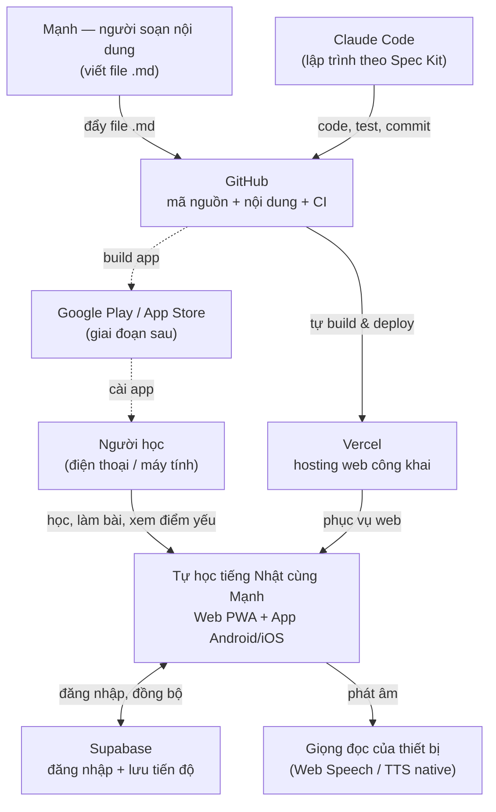

---

## 3. Sơ đồ container (C4 cấp 2)

Các khối chạy độc lập và dữ liệu đi giữa chúng.

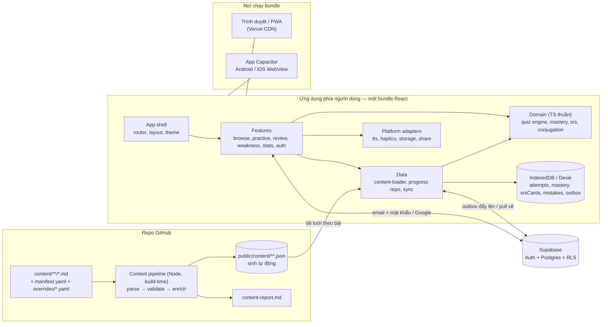

**Điểm mấu chốt:** web và app **không phải hai dự án**. Capacitor chỉ bọc cùng bundle `dist/` vào một vỏ native; khác biệt nền tảng (giọng đọc, rung, chia sẻ, deep link) được cô lập trong `src/platform/`.

---

## 4. Kiến trúc frontend phân lớp (C4 cấp 3)

### 4.1 Các lớp và chiều phụ thuộc

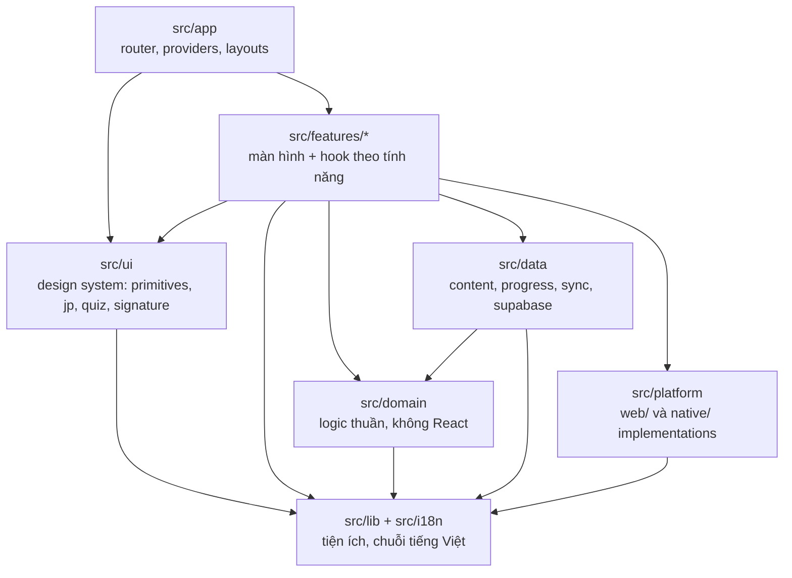

### 4.2 Luật phụ thuộc (bắt buộc, kiểm bằng ESLint `no-restricted-imports`)

| Lớp | Được import | **Không** được import |
|---|---|---|
| `domain/` | `lib/` | React, Dexie, Supabase, `data/`, `features/`, `ui/`, `platform/` |
| `data/` | `domain/`, `lib/` | React component, `features/`, `ui/` |
| `ui/` | `lib/`, `i18n/` | `features/`, `data/`, `domain/` (chỉ nhận dữ liệu qua props) |
| `features/A` | `ui/`, `domain/`, `data/`, `platform/`, `lib/` | `features/B` (dùng chung thì đưa xuống `ui/` hoặc `domain/`) |
| `platform/` | `lib/` | mọi lớp khác; chỉ file trong `platform/native/` được import `@capacitor/*` |
| Ngoài `data/progress/dexie-repo.ts` | — | `dexie` |
| Ngoài `data/supabase-client.ts` | — | `@supabase/supabase-js` |

### 4.3 Hai "điểm cắm" để mở rộng

1. **Dạng câu hỏi mới** = thư mục mới `src/features/practice/modes/<id>/` + `questionRegistry.register(...)` (*KH §6.4*). Session runner không sửa.
2. **Nền tảng mới / API thiết bị mới** = thêm interface trong `src/platform/types.ts` + hai bản cài `web/` và `native/`. Feature chỉ gọi `platform.tts.speak(...)`.

---

## 5. Luồng dữ liệu chính

### 5.1 Từ file Markdown tới màn hình

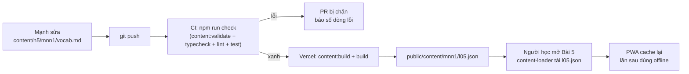

### 5.2 Trả lời một câu hỏi (luồng lõi phát hiện điểm yếu)

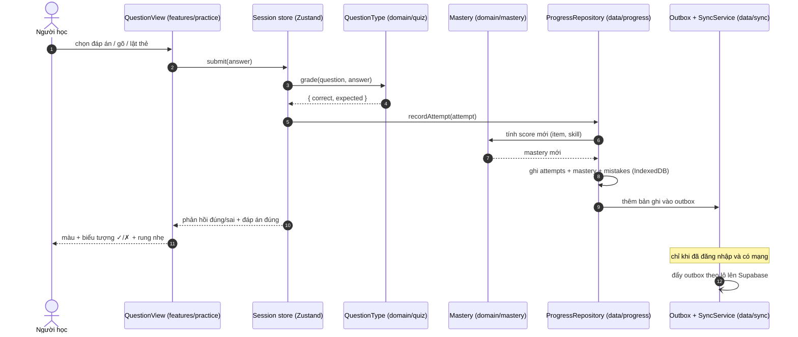

### 5.3 Trạng thái đồng bộ

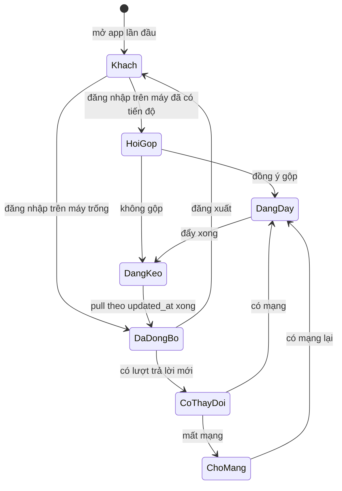

Nhãn hiển thị cho người dùng (trang Tài khoản): *Khach* → "Đang lưu trên máy này", *ChoMang* → "Chưa đồng bộ — sẽ tự gửi khi có mạng", *DaDongBo* → "Đã đồng bộ lúc 10:32".

---

## 6. Mô hình dữ liệu

### 6.1 Dữ liệu nội dung (chỉ đọc, sinh lúc build) — chi tiết kiểu ở *KH §6.1*

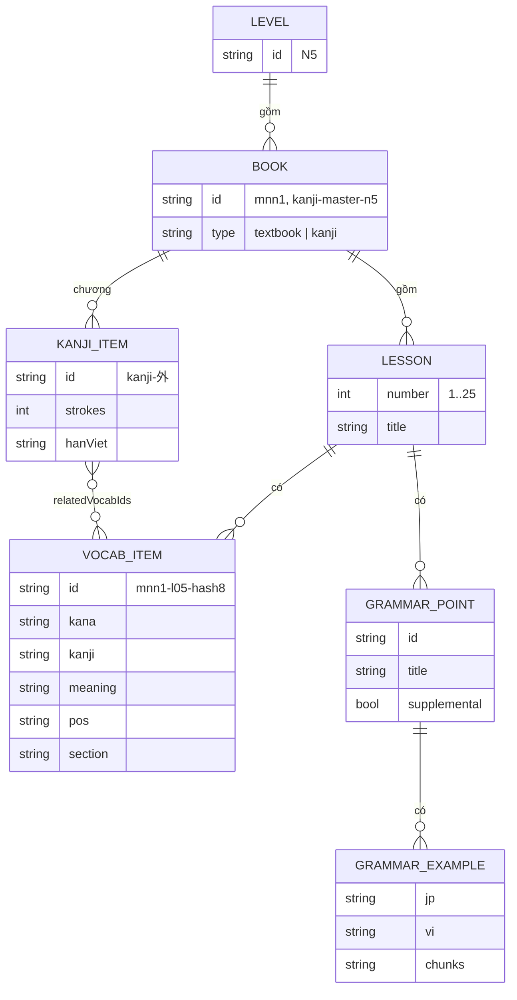

### 6.2 Dữ liệu tiến độ (ghi được) — IndexedDB và Supabase cùng hình dạng

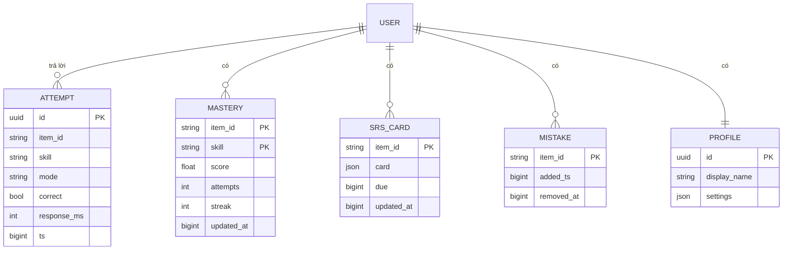

- Khóa nối giữa tiến độ và nội dung **chỉ là `item_id` ổn định** (*KH §6.2*). Sửa nghĩa trong `.md` không làm mất tiến độ.
- Ở máy: thêm bảng `outbox`, `sessions`, `settings` (*KH §6.7*). Trên Supabase mọi bảng có `user_id` + RLS `user_id = auth.uid()` (*KH §6.8*).

---

## 7. Triển khai: web + app

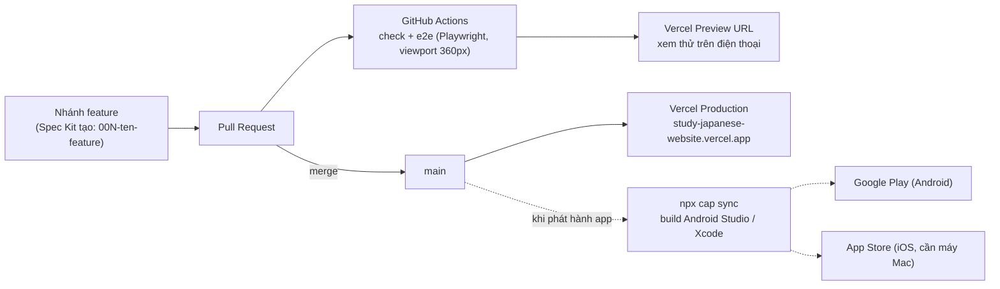

| Mục tiêu | Lệnh | Ghi chú |
|---|---|---|
| Web dev | `npm run dev` | http://localhost:5173 |
| Web production | tự động khi merge `main` | Vercel chạy `npm run content:build && npm run build` |
| App Android | `npm run build && npx cap sync android && npx cap open android` | Cần Android Studio. Làm ở spec *Native app* |
| App iOS | `npm run build && npx cap sync ios && npx cap open ios` | Cần máy Mac + Xcode + tài khoản Apple Developer |

---

## 8. Cấu trúc thư mục chuẩn (Spec Kit + mã nguồn)

> Đây là phần sửa tình trạng "file lộn xộn". **Mỗi loại file chỉ có một chỗ ở.** Bảng 8.2 trả lời câu hỏi "file này đặt ở đâu?".

### 8.1 Cây thư mục

```
tu-hoc-tieng-nhat-cung-manh/
├── CLAUDE.md                     # Ngắn: trỏ tới constitution + docs + lệnh. Không chứa thiết kế chi tiết
├── README.md                     # Cho con người: chạy dự án thế nào
│
├── .specify/                     # ⚙️ Spec Kit tạo — KHÔNG sửa tay trừ constitution
│   ├── memory/
│   │   └── constitution.md       # ⭐ Luật bất biến của dự án (/speckit-constitution)
│   ├── templates/                # mẫu spec/plan/tasks của Spec Kit
│   └── scripts/                  # script tạo nhánh, tạo thư mục spec
├── .claude/
│   ├── skills/speckit-*/         # (hoặc commands/) — lệnh /speckit-* do Spec Kit cài
│   └── settings.json
│
├── specs/                        # 📋 Mỗi feature một thư mục, đánh số theo thứ tự tạo
│   ├── 001-repo-restructure/
│   │   ├── spec.md               # CÁI GÌ & TẠI SAO (không có công nghệ)
│   │   ├── plan.md               # LÀM THẾ NÀO (tuân theo docs/ARCHITECTURE.md)
│   │   ├── research.md           # (tùy) so sánh lựa chọn
│   │   ├── data-model.md         # (tùy) kiểu dữ liệu riêng của feature
│   │   ├── contracts/            # (tùy) interface, schema
│   │   ├── quickstart.md         # cách tự kiểm tra feature
│   │   ├── checklists/           # (tùy) /speckit-checklist
│   │   └── tasks.md              # danh sách việc (/speckit-tasks)
│   ├── 002-content-pipeline/
│   └── ...
│
├── docs/                         # 📚 Tài liệu cấp hệ thống, dùng chung mọi feature
│   ├── ARCHITECTURE.md           # file này
│   ├── FRONTEND.md               # hướng dẫn xây giao diện web + app cho Claude Code
│   ├── CONTENT_GUIDE.md          # cách soạn file .md nội dung (= KH §5 + Phụ lục B)
│   ├── SPECKIT_ROADMAP.md        # thứ tự feature + prompt mẫu cho /speckit-*
│   └── reference/
│       ├── Ke_hoach_Website.md   # kế hoạch gốc v1.2 (tham chiếu, không sửa nữa)
│       └── Bao_cao_kiem_tra_du_lieu_N5.md
│
├── content/                      # ✍️ NƠI DUY NHẤT soạn nội dung học
│   ├── manifest.yaml
│   ├── n5/mnn1/{vocab,grammar}.md
│   ├── n5/kanji-master-n5/kanji.md
│   └── overrides/{verb-groups,pos,id-aliases}.yaml
│
├── scripts/content/              # pipeline build nội dung (Node/TS)
│   ├── parse-vocab.ts  parse-grammar.ts  parse-kanji.ts
│   ├── validate.ts  enrich.ts  ids.ts  build.ts
│
├── src/                          # 💻 Mã ứng dụng — chi tiết trong docs/FRONTEND.md §4
│   ├── app/        # router, providers, layouts
│   ├── features/   # browse, practice(+modes/), review, weakness, stats, auth, settings
│   ├── ui/         # design system: tokens.css, primitives/, jp/, quiz/, signature/
│   ├── domain/     # types, schemas, quiz/, mastery/, srs/, conjugation/
│   ├── data/       # content-loader, progress/, sync/, hooks/, supabase-client.ts
│   ├── platform/   # types.ts, web/, native/, index.ts
│   ├── lib/        # kana.ts, normalize.ts, rng.ts, format.ts
│   └── i18n/       # vi.ts
│
├── public/
│   ├── content/                  # 🤖 SINH TỰ ĐỘNG — không sửa tay, không commit (gitignore)
│   ├── icons/  manifest.webmanifest
├── tests/e2e/                    # Playwright (unit test đặt cạnh file: *.test.ts)
├── supabase/migrations/          # SQL + RLS
├── android/  ios/                # 📱 Capacitor tạo ở spec Native app — không sửa tay trừ cấu hình native
├── capacitor.config.ts
├── vercel.json  .env.example  package.json  vite.config.ts  tsconfig.json  eslint.config.js
└── .github/workflows/ci.yml
```

### 8.2 "File này đặt ở đâu?"

| Bạn có… | Đặt ở | Ai tạo |
|---|---|---|
| Luật áp dụng cho **mọi** feature (VD: không viết cứng N5) | `.specify/memory/constitution.md` | `/speckit-constitution` |
| Ý tưởng một tính năng mới | `specs/NNN-ten/spec.md` | `/speckit-specify` |
| Cách làm kỹ thuật của tính năng đó | `specs/NNN-ten/plan.md` | `/speckit-plan` |
| Danh sách việc cần code | `specs/NNN-ten/tasks.md` | `/speckit-tasks` |
| Thiết kế dùng chung (sơ đồ, lớp, thư mục) | `docs/ARCHITECTURE.md` | sửa tay / nhờ Claude |
| Quy tắc giao diện, màu, font, component | `docs/FRONTEND.md` | sửa tay / nhờ Claude |
| Từ vựng, ngữ pháp, Kanji | `content/<level>/<book>/*.md` | Mạnh |
| Tài liệu cũ, báo cáo, ghi chú một lần | `docs/reference/` | — |
| Ghi chú nháp, thử nghiệm | **không commit**, hoặc `docs/reference/notes/` | — |

**Không được có:** file `.md` lẻ ở gốc repo (ngoài `CLAUDE.md`, `README.md`), thư mục `old/`, `backup/`, `new/`, file `*-copy.tsx`, `*-v2.tsx`. Bản cũ đã có git lưu.

---

## 9. Bản đồ feature (specs) & thứ tự làm

Mỗi ô là **một lần chạy trọn quy trình Spec Kit** (specify → plan → tasks → implement). Số thứ tự do script Spec Kit tự cấp theo thứ tự bạn tạo; giữ đúng thứ tự dưới đây thì số sẽ khớp.

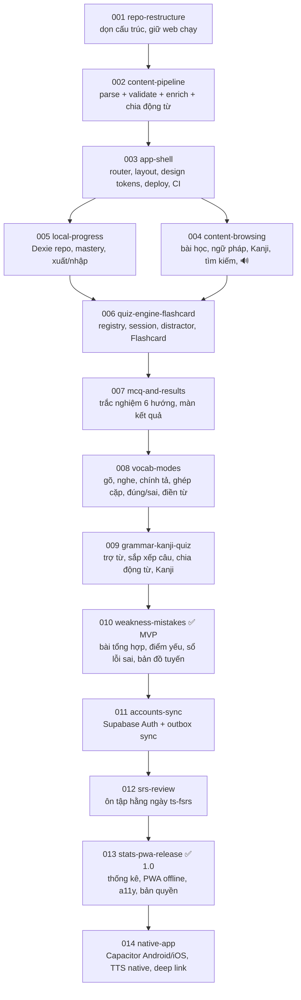

| Spec | Ứng với Phase cũ (KH §10) | Dấu hiệu hoàn thành chính |
|---|---|---|
| 001 repo-restructure | — (mới) | Cây thư mục khớp §8.1, web trên Vercel vẫn chạy y như cũ |
| 002 content-pipeline | Phase 1 + 2 | 1.020 từ chính + 272 mở rộng, 132 mẫu ngữ pháp, 119 + 15 Kanji; test chia động từ 100% |
| 003 app-shell | Phase 0 (phần còn thiếu) + 3 | Menu sinh từ manifest; `/b/mnn1/5` mở thẳng không 404; tokens trong `ui/tokens.css` |
| 004 content-browsing | Phase 4 | Tìm "nuoc ngoai" ra 外国 |
| 005 local-progress | Phase 5 | Xuất → xóa → nhập lại → dữ liệu như cũ |
| 006 quiz-engine-flashcard | Phase 6 | Flashcard Bài 1, tải lại trang mastery > 0 |
| 007 mcq-and-results | Phase 7 | Sai 2/10 → "Làm lại câu sai" đúng 2 câu |
| 008 vocab-modes | Phase 8 | `gaikoku` → がいこく chấm đúng |
| 009 grammar-kanji-quiz | Phase 9 | Mỗi bài ngữ pháp sinh ≥ 5 câu trợ từ |
| 010 weakness-mistakes | Phase 10 | Sai nhiều Bài 3 → Bài 3 đỏ và đứng đầu điểm yếu |
| 011 accounts-sync | Phase 11 | Hai thiết bị cùng mastery; RLS chặn tài khoản khác |
| 012 srs-review | Phase 12 | Thẻ *Quên* quay lại sớm hơn thẻ *Dễ* |
| 013 stats-pwa-release | Phase 13 | Cài lên màn hình chính, offline vẫn học |
| 014 native-app | Phase 14 (một phần) | APK cài được, phát âm chạy trên Android |

Prompt mẫu cho từng spec: xem `docs/SPECKIT_ROADMAP.md`.

---

## 10. Quy trình Spec Kit áp dụng cho dự án

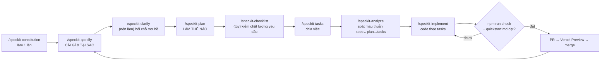

**Cổng chất lượng (gate) giữa các bước — bạn là người duyệt:**

| Sau bước | Bạn kiểm tra | Nếu sai |
|---|---|---|
| specify | Đọc `spec.md`: có đúng điều bạn muốn? Không có tên thư viện/công nghệ? Có tiêu chí "xong" đo được? | Sửa bằng lời rồi chạy lại `/speckit-clarify` |
| plan | `plan.md` có mục "Constitution Check" đều đạt? Có dùng đúng lớp/thư mục ở §4, §8? | Nhắc: "plan phải tuân theo docs/ARCHITECTURE.md §4.2" |
| tasks | Task có đường dẫn file cụ thể? Có task viết test trước? | Chạy lại `/speckit-tasks` |
| implement | `npm run check` xanh, mở Preview trên điện thoại thử | Không merge |

---

## 11. Quyết định kiến trúc (ADR)

| # | Quyết định | Lý do | Hệ quả |
|---|---|---|---|
| ADR-001 | **Local-first**: IndexedDB là nguồn chính, Supabase chỉ để đồng bộ | Offline, nhanh, không bắt đăng nhập | Cần outbox + giải quyết xung đột "bản mới hơn thắng" |
| ADR-002 | **Content-as-data**: nội dung chỉ ở `content/*.md`, build ra JSON | Thêm N4 không sửa code; Mạnh tự soạn được | Phải có validator chặt + CI |
| ADR-003 | **Một codebase, Capacitor cho app** (không React Native) | Đã có web React + Vite chạy trên Vercel; người mới chỉ cần học một cách làm; IndexedDB/Tailwind dùng lại 100% | Cảm giác "native" kém RN một chút → bù bằng safe-area, haptics, chuyển trang mượt; TTS Android phải dùng plugin native |
| ADR-004 | **Supabase** cho Auth + Postgres + RLS | Miễn phí, có sẵn đăng ký/quên mật khẩu/Google | Gói Free tạm dừng khi lâu không dùng → app phải chạy được khi Supabase không phản hồi |
| ADR-005 | **Design tokens một chỗ** (`src/ui/tokens.css`, Tailwind v4 `@theme`) | Tránh mã màu rải rác, giữ nhận diện riêng | Mọi component chỉ dùng class token, không dùng mã hex trực tiếp |
| ADR-006 | **Spec Kit** cho mọi thay đổi lớn hơn sửa lỗi nhỏ | Người làm chưa có kinh nghiệm frontend → cần spec rõ trước khi code | Sửa lỗi nhỏ (< 30 dòng) được làm thẳng, nhưng vẫn phải `npm run check` |

Khi đổi một quyết định ở đây: thêm dòng ADR mới (không xóa dòng cũ), cập nhật constitution nếu quyết định đó là luật bất biến.
